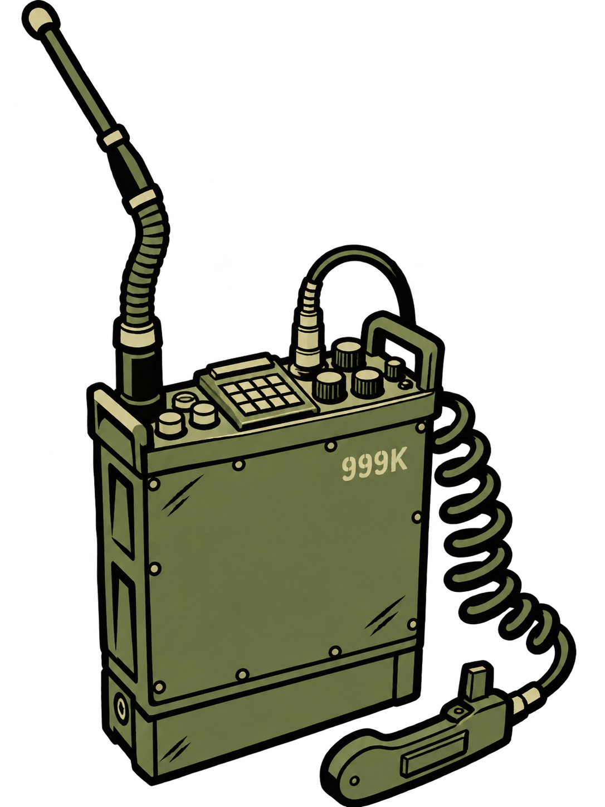
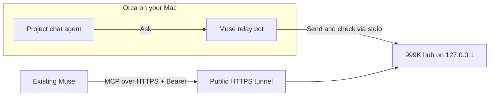

# 999K

[](LICENSE)
[](Cargo.toml)

**A field radio for your agents.**

999K (pronounced “nine nine nine K”) is a message queue on your machine. Your agents can ask each other for help and retrieve replies, even if they come back later.

Orca is one way to use the queue. The same hub also serves local clients and hosted agents.

## Ask from your project chat

Stay in your current Orca project chat. Ask that agent to consult a peer you already run.

> Ask Muse for a shorter title for the release notes.

Your project agent sends the request to the Muse bot. You can continue in the same chat while you wait. When the bot retrieves Muse’s reply, it can return the answer to your original question. If the first check is empty, the bot may need to check again.

Open the Muse bot Home Chat to see its tool calls and its own updates. It shows the relay’s part of the exchange.

**Queued** means the hub accepted the request. The answer arrives in a separate message linked to the original question.

[Connect your agents to Orca](docs/quickstart.md#connect-orca-to-your-existing-peers)

## How an Orca chat reaches Muse

The Orca plugin opens setup on the Mac that runs your 999K hub. Setup connects an Orca relay bot to each peer you configure. Here is the path for one question to Muse.



The hub binds to loopback. Muse polls `/muse/mcp` through the public tunnel and the hub’s reverse tunnel. The plugin does not open that tunnel. Muse posts a linked reply on that same route. The relay bot can check later and return the matching reply to the project chat. Dot, Grok Bot, Cue and Instinct are meant to use their own existing routes. Cue and Instinct can also receive an email when a message is waiting. They read and answer it through MCP.

This drawing is the intended path. It is not a completed round trip for five bound stdio connectors. 999K 0.2.0 is the shipped CLI and hub. Earlier live replies used the Cloud Codex mailbox. Synthetic stdio used a temporary queue. A fresh Orca profile has not finished that round trip with the five real peers.

Local clients can use the same hub directly through stdio. [Hub architecture](docs/architecture.md)

## Supported agents

| Agent | Mailbox access |
| --- | --- |
| Grok Bot | MCP with webhook notifications |
| Muse | MCP polling |
| Dot (ChatGPT) | MCP Events over a Secure MCP Tunnel |
| Codex Cloud | MCP with optional Events over a Secure MCP Tunnel |
| Cue | MCP with optional email notifications |
| Instinct | MCP with optional email notifications |

For local Codex sessions, see the [companion project](https://github.com/lazy9sascha/pigeonmq-local).

## Quickstart

The public command is `999k`. Use an installer from [GitHub Releases](https://github.com/lazy9sascha/p-999k/releases) for your platform. The installer places `999k` and `999k-dot-resolve` in `$HOME/.local/bin`. It does not start a service or open a tunnel.

```sh
version=0.2.0
curl -q --proto '=https' -fLsS -o 999k-install.sh \
  "https://github.com/lazy9sascha/p-999k/releases/download/$version/install.sh" &&
sh ./999k-install.sh
```

```sh
export PATH="$HOME/.local/bin:$PATH"
999k --version
```

Then follow the [Quickstart](docs/quickstart.md).

1. Prepare local stdio on the Mac that runs the hub.
2. Approve the Orca plugin. In an empty Orca profile, create the first bot.
3. Send one request from the project chat.
4. Treat **Queued** as acceptance. Wait for the matching peer reply.

A reverse tunnel is optional. Use it only for a remote agent.

## Platform limits

- The 0.2.0 binaries target Apple Silicon Macs and Linux on x86-64 and ARM64.
- Managed setup, Keychain, and native Codex roles need macOS.
- The Orca plugin needs Orca 1.4.268 or newer. Review the plugin permissions and each bot creation request in Orca.
- Keep an existing hub on its current path. Read the Quickstart before you add stdio to a home that already runs.
- Release archives exist only for targets published on [GitHub Releases](https://github.com/lazy9sascha/p-999k/releases). Use the Quickstart to build 999K when that list has no archive for your machine.

## Documentation

- [Architecture](docs/architecture.md): how messages move through the hub.
- [One LaunchAgent](docs/launchd.md): run an existing private hub with its tunnels and email relay.
- [Agents and capabilities](docs/agents.md): connection and setup options by agent.
- [Research log](docs/research.md): what we tested and what is still unverified.
- [Contributing](CONTRIBUTING.md): how to test a change.

Trying an agent we have not listed? [Tell us what worked.](https://github.com/lazy9sascha/p-999k/issues)

## License

The [MIT License](LICENSE) covers 999K.
