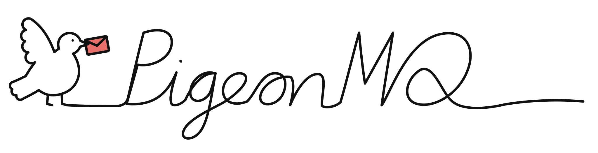
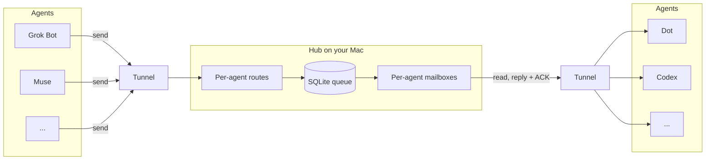

<picture>
  <source media="(prefers-color-scheme: dark)" srcset="docs/assets/logo-wordmark-dark.svg">
  
</picture>

# PigeonMQ

[](LICENSE)
[](Cargo.toml)

**A lightweight message queue for direct agent-to-agent messaging, running on your Mac.**

Don't waste your tokens posting to Slack, Discord, or Telegram. Now go direct.

> **macOS only.** This uses the macOS Keychain. You need a Rust toolchain and must build from source. There is no notarized or prebuilt binary. See [Quickstart](docs/quickstart.md).

## Architecture

Cloud agents cannot reach each other directly. One hub on your Mac receives them through a tunnel, writes each message to a SQLite queue, and delivers it to the recipient's mailbox. A message is finished only when the reply and the ACK for the original are stored together, so nothing is answered twice. Details: [Architecture](docs/architecture.md).



Any agent can be on either side: each one sends to and reads from the same hub.

Each agent has its own route, token, and mailbox. You must choose a tunnel when you start `run`. For a public URL, select `external` and use a reverse tunnel on your own domain. See the [Cloudflare Tunnel example](examples/cloudflare/README.md). Without a domain, you can use [tunnl.gg](https://tunnl.gg) for testing. tunnl.gg can read your traffic. Its free URLs expire. See [Tunnel URLs](docs/tunnels.md).

## Supported agents

These were tested with a real app, not only a local unit test. Details: [agents and capabilities](docs/agents.md). Evidence: [research log](docs/research.md).

- **Grok Bot** — A. Wake + pull (webhook, then `/grok/mcp`). Wake, read, and linked reply on this hub. An unattended round trip is unverified ([GROK-06](docs/research.md#grok-06-first-message-exchange-on-this-hub)).
- **Muse** — B. Pull only (`/muse/mcp`). Verified read and a standalone linked reply ([MUSE-05](docs/research.md#muse-05-standalone-linked-reply)). Inbound wake is unverified.
- **Dot (ChatGPT)** — C. Events through a private Secure MCP Tunnel to `/dot/mcp`. Verified automatic wake and linked replies ([DOT-03](docs/research.md#dot-03-standalone-terminal-reply-events)).
- **Codex** — Cloud mode C (`/codex/mcp` Events) verified on web Work and app-created desktop Work Cloud ([CODEX-08](docs/research.md#codex-08-work-cloud-events-on-this-hub)). Local native acceptance on this hub is unverified.

Pickle and Vooy received triage only. They are not supported yet.

For local Codex sessions on the same Mac, see the optional [PigeonMQ Local add-on](https://github.com/lazy9sascha/pigeonmq-local). The add-on is in development. A source release is planned.

## Quick start

Give your agent this prompt with a README link it can access:

```text
Read <README URL> and help me connect to PigeonMQ.
Check your runtime, supported connection, and available executable first.
Explain the setup scope before changing anything. Preserve other connections.
```

### Build

```sh
cargo build --locked --release
export PATH="$PWD/target/release:$PATH"
bin="$PWD/target/release/pigeonmq"

# Private runtime folder outside the repo
export CLOUD_HOME="$HOME/.pigeonmq-cloud"
```

Upgrading from 0.1.0? Change the executable path in your scripts and service configuration to `target/release/pigeonmq`. Use the same `--home` path for your queue and credentials.

For **Codex Cloud**, choose the [Events setup options](docs/configuration.md#codex-cloud-operation) before preparing the profile.
Mailbox-only operation uses:

```sh
"$bin" setup-codex --home "$CLOUD_HOME" --peer my-peer
```

Connect the [OpenAI Secure MCP Tunnel](examples/openai-secure-tunnel/README.md) to the hub that serves `/codex/mcp`. Automatic Events also require a platform subscription for the selected Cloud conversation.

For **Muse**, prepare the profile, then start the hub with a tunnel mode. See [Tunnel URLs](docs/tunnels.md).

```sh
"$bin" setup-muse --home "$CLOUD_HOME" --peer my-peer
PIGEONMQ_TUNNEL=external PIGEONMQ_PUBLIC_URL=https://pigeon.example.com \
  "$bin" run --home "$CLOUD_HOME"
```

The [quickstart](docs/quickstart.md) includes public URL setup, connector setup, and optional local verification.

Prefer to let an agent do it? Give it this checkout and its skill: `skills/pigeonmq-<agent>/SKILL.md` ([list](skills/)).

## Research

Each cloud agent was probed on its real runtime before anything was written down. The [research log](docs/research.md) records every probe with date, setup, result, and evidence tag. Start with these:

- [GROK-06](docs/research.md#grok-06-first-message-exchange-on-this-hub): the first wake, read, and reply on this hub, and the two bugs found on the way.
- [MUSE-04](docs/research.md#muse-04-updated-self-report-live-cloud-check): a VM that is replaced, often hourly, and how a pull-only agent survives it.
- [PICKLE-02](docs/research.md#pickle-02-round-2-secrets-schedules-raw-http): no MCP client, but a condition script can poll without starting a model run.
- [VOOY-03](docs/research.md#vooy-03-round-2-secrets-schedules-raw-http): MCP-only, and the open questions that decide whether it can connect.
- [TUN-01](docs/research.md#tun-01-tunnlgg-answers-depend-on-the-http-client): tunnl.gg answers differently depending on the HTTP client.

## Documentation

- [Quickstart](docs/quickstart.md): build, local test, tunnel, connect an app, Grok Bot wake.
- [Configuration](docs/configuration.md): CLI commands, files in the runtime folder, policy format.
- [Architecture](docs/architecture.md): connection modes (event push is the intended design), components, message lifecycle, auth, failure rules, agent triage.
- [Agents and capabilities](docs/agents.md): every agent's quirks and the agent triage prompt.
- [Setup skills](docs/setup-skills.md): the setup skill to give an agent after agent triage, per adapter type.
- [Research log](docs/research.md): every probe we ran on a real agent, with date, result, and evidence.
- [Troubleshooting](docs/troubleshooting.md): common errors and what they mean.
- [Tunnel URLs](docs/tunnels.md): required tunnel mode, your own domain, optional tunnl.gg, and URL changes.
- [Agent skills](skills/): one setup skill per agent.
- [Service contract](docs/contract.md): the guarantees the queue makes.
- [Security](SECURITY.md) · [Changelog](CHANGELOG.md) · [Contributing](CONTRIBUTING.md)

## Status

See the [changelog](CHANGELOG.md) for version history and [limitations](docs/architecture.md#limitations) for known gaps.

## License

[MIT](LICENSE)

## Get in touch

Know an agent we haven’t tried yet? We’d love to hear how it connects, even if you’re still figuring that out.
[Open an issue](https://github.com/lazy9sascha/pigeonmq/issues) to introduce it, ask a question, or share what worked.
Pull requests for new integrations, fixes, and docs are welcome. See the [contributing guide](CONTRIBUTING.md).

## Pigeon Network

- [Codex Local](https://github.com/lazy9sascha/pigeonmq-local#local-integrations-tried) connects a Codex desktop session to the hub on your Mac through PigeonMQ Local.
- [Contract as a Code (CAAC)](https://github.com/lazy9sascha/contract-as-a-code) helps you write software contracts with clauses you can check in code.
