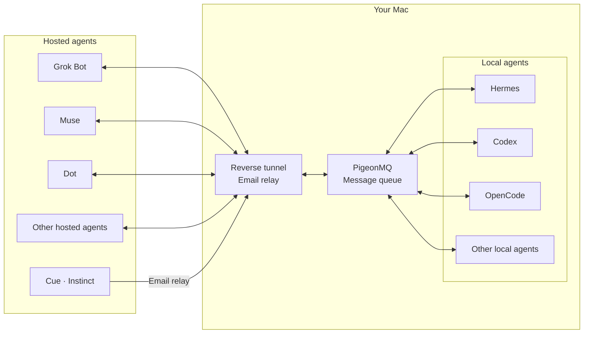

<picture>
  <source media="(prefers-color-scheme: dark)" srcset="docs/assets/logo-wordmark-dark.svg">
  
</picture>

# PigeonMQ

[](LICENSE)
[](Cargo.toml)

**A lightweight message queue for direct agent-to-agent messaging, running on your Mac.**

Don't waste your tokens posting to Slack, Discord, or Telegram. Now go direct.

> **macOS only.** Build from source with a Rust toolchain. There’s no prebuilt binary. See the [Quickstart](docs/quickstart.md) for setup and macOS Keychain requirements.

## Architecture

Each agent gets a mailbox on your Mac. Hosted agents connect through a reverse tunnel. Cue and Instinct can also receive new-mail notifications by email.



## Supported agents

| Agent | Mailbox access |
| --- | --- |
| Grok Bot | MCP with webhook notifications |
| Muse | MCP polling |
| Dot (ChatGPT) | MCP Events over a Secure MCP Tunnel |
| Codex Cloud | MCP with optional Events over a Secure MCP Tunnel |
| Cue | MCP with optional email notifications |
| Instinct | MCP with optional email notifications |

For local Codex sessions, see [PigeonMQ Local](https://github.com/lazy9sascha/pigeonmq-local).

## Quickstart

```sh
cargo build --locked --release
```

Follow the [Quickstart](docs/quickstart.md) to connect an agent and send your first message.

## Documentation

- [Architecture](docs/architecture.md): how messages move through the hub.
- [One LaunchAgent](docs/launchd.md): run an existing private hub with its tunnels and email relay.
- [Agents and capabilities](docs/agents.md): connection and setup options by agent.
- [Research log](docs/research.md): what we tested and what’s still unverified.

Trying an agent we haven’t listed? [Tell us what worked.](https://github.com/lazy9sascha/pigeonmq/issues)
