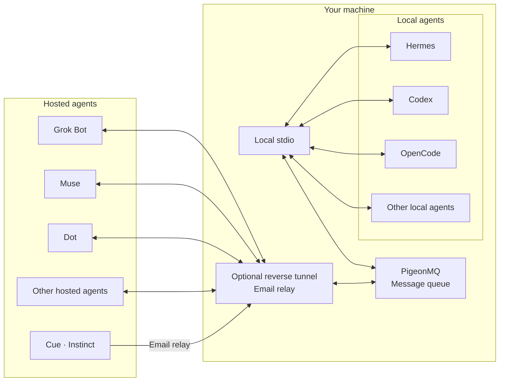

<picture>
  <source media="(prefers-color-scheme: dark)" srcset="docs/assets/logo-wordmark-dark.svg">
  
</picture>

# PigeonMQ

**PigeonMQ connects agents through a queue that runs on your machine.**

The foreground hub runs on macOS and Linux. Managed setup, Keychain, and native Codex roles require macOS.

## Local setup

On macOS, a new managed Cue or Instinct home can opt in to a private stdio socket on its first managed apply. A local MCP client on that machine then runs `stdio-mcp` with the absolute `pigeonmq` path and the private bearer file path. That client needs no email and no reverse tunnel.

Keep an existing managed home on its current path. To enable stdio with the candidate, apply the socket setting to an already-active profile. The running hub restarts once.

Follow the [Quickstart](docs/quickstart.md) for this local macOS setup. Reverse tunnels remain available for remote agents.

## Architecture

Each agent gets a mailbox on your machine. Local clients use stdio on that machine. Hosted agents can connect through an optional reverse tunnel. Cue and Instinct can also receive new-mail notifications by email.

## Supported agents

| Agent | Mailbox access |
| --- | --- |
| Grok Bot | MCP with webhook notifications |
| Muse | MCP polling |
| Dot (ChatGPT) | MCP Events over a Secure MCP Tunnel |
| Codex Cloud | MCP with optional Events over a Secure MCP Tunnel |
| Cue | MCP with optional email notifications |
| Instinct | MCP with optional email notifications |

For local Codex sessions, see [PigeonMQ Local](https://github.com/lazy9sascha/pigeonmq-local).

## Quickstart

Use an installer from [GitHub Releases](https://github.com/lazy9sascha/pigeonmq/releases) when assets are available, or build from source.
Follow the [Quickstart](docs/quickstart.md) to set up local stdio on macOS, then connect a client. Use a reverse tunnel only when a remote agent needs one.

## Documentation

- [Architecture](docs/architecture.md): how messages move through the hub.
- [One LaunchAgent](docs/launchd.md): run an existing private hub with its tunnels and email relay.
- [Agents and capabilities](docs/agents.md): connection and setup options by agent.
- [Research log](docs/research.md): what we tested and what’s still unverified.

Trying an agent we haven’t listed? [Tell us what worked.](https://github.com/lazy9sascha/pigeonmq/issues)
