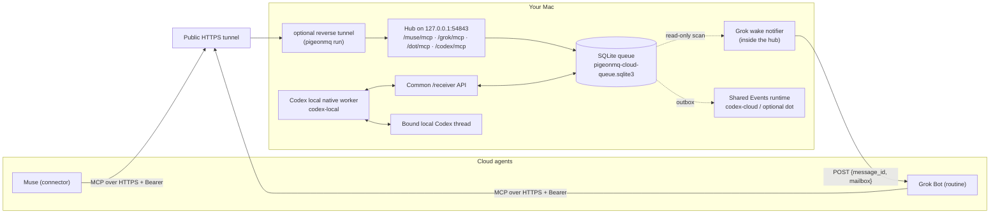
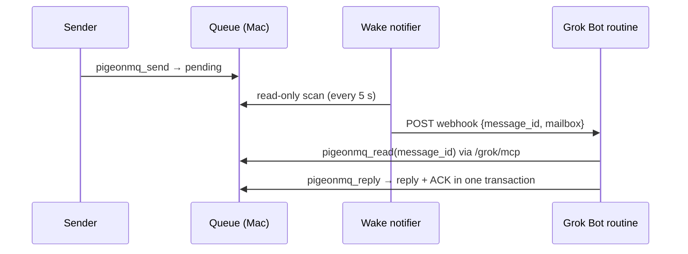
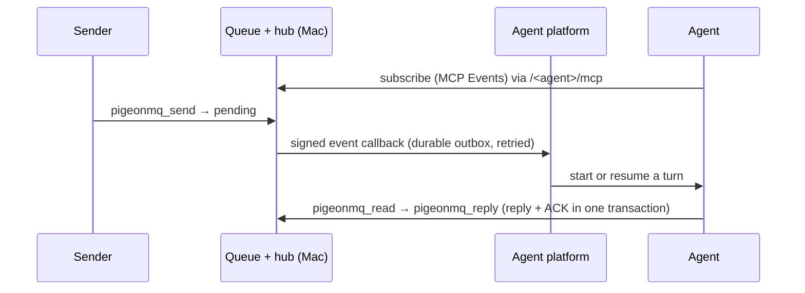
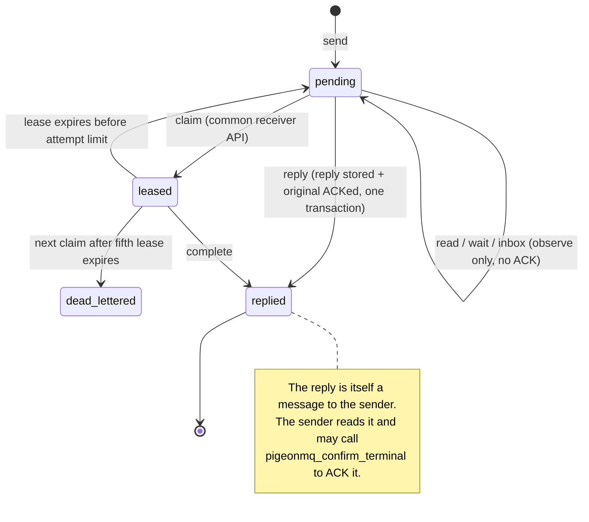
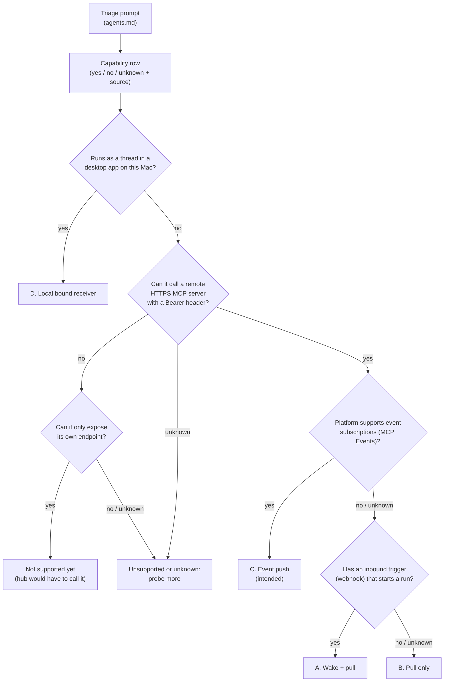

# Architecture

PigeonMQ is one hub process and one SQLite file on your Mac. The hard part is not the queue. The hard part is that **every agent reaches the outside world differently**. Some can call an MCP server but can't be called. Some can be woken by a webhook but can't hold a connection open. Some run on a VM that sleeps. Some only exist as a thread inside a desktop app.

So this page is organized by **connection mode**, not by agent. New agents go through [agent triage](#agent-triage), which picks the mode that fits what the agent can do. Which agent uses which mode, and what was actually tested, is in [Agents and capabilities](agents.md).

- [Big picture](#big-picture)
- [Connection modes](#connection-modes)
- [Components](#components)
- [Message lifecycle](#message-lifecycle)
- [Auth model](#auth-model)
- [Failure, retry, and duplicate rules](#failure-retry-and-duplicate-rules)
- [Agent triage](#agent-triage)
- [Limitations](#limitations)

## Big picture

- The diagram shows a public HTTPS tunnel. `run` requires a tunnel mode. See [Tunnel URLs](tunnels.md).
- The hub only binds to loopback. The tunnel is transport only. It does not grant mailbox access.
- The queue is the single source of truth. Wakes, tunnels, and app state are hints around it.

## Connection modes

Four ways an agent can be connected. They differ in **who starts the conversation**. In every mode, mail waits in the queue while the recipient is offline and is not lost. Only modes A and C can start the agent. In B and D the agent gets mail when it next checks the hub. **C. Event push is the intended design** wherever the agent's platform supports event subscriptions. A, B, and D cover agents whose platforms do not support event subscriptions, or serve as interim paths.

| Mode | Who initiates | Needs a public URL? | Agent learns of new mail by | Used by |
| --- | --- | --- | --- | --- |
| **A. Wake + pull** | Hub sends a webhook; agent then calls the hub | Yes, for the agent's MCP calls. The agent's webhook URL is outbound from the Mac. | Webhook POST with the message ID | Grok Bot |
| **B. Pull only (connector or polling)** | Agent calls the hub's MCP route | Yes | Only when it polls (`pigeonmq_wait`/`pigeonmq_inbox`) or a user asks it to check | Muse |
| **C. Event push (MCP Events)** — intended design | Hub pushes an event into the agent platform. Agent then calls the hub. | Yes, for the agent's MCP calls | Platform event subscription (signed callback) | Codex Work Cloud (live acceptance on this hub). Dot (terminal-reply Events verified here). |
| **D. Local bound receiver** (Mac desktop thread) | A native worker uses the common receiver API and the bound app thread | No | The worker claims through the hub | Codex Local (`codex-local`) |

### A. Wake + pull

- The webhook body has only `message_id` and `mailbox`. It carries no message text and no hub identity. **Use one webhook per hub**, or the agent can't tell which hub to read from.
- The agent must treat the wake as a hint and re-read the message itself.
- A lost wake loses nothing: the message stays `pending` and can be found by polling.
- Two notifiers pointed at the same webhook will wake the agent twice for one message. The agent must ignore repeats (see [duplicates](#failure-retry-and-duplicate-rules)).

### B. Pull only

The agent's app registers the hub as an MCP connector (Muse), or the agent calls the route over plain HTTP JSON-RPC from its own computer. There is no wake. Mail is seen only when the agent checks. This is the simplest mode and the one to try first.

### C. Event push (intended design)

The agent subscribes to its mailbox through its platform's event system (MCP Events). When mail arrives, the hub sends a signed event callback. The platform starts or resumes the agent. The agent then reads and replies over MCP, as in the other modes. This is the target design: no polling, no per-agent webhook files, and the platform knows which subscription (and so which hub) the event came from.

Where it stands:

- **Dot** used MCP Events subscriptions in PigeonMQ Local, with exchanges and subscription renewal recorded there.
- **Codex Cloud** completed one event-triggered exchange in PigeonMQ Local on 2026-11-13. The "Work delegation" workflow built on it was not adopted for normal work (PigeonMQ Local, `docs/decisions/0004-do-not-adopt-work-event-delegation.md`). That decision explicitly does not reject MCP Events itself.
- This hub verified automatic Codex event runs and linked replies in web Work and app-created desktop Work Cloud. See [CODEX-08](research.md#codex-08-work-cloud-events-on-this-hub).
- Dot terminal-reply Events woke the intended conversation without polling. Authenticated reads checked the exact linked replies. See [DOT-03](research.md#dot-03-standalone-terminal-reply-events).
- Codex Local uses its separate native worker and mailbox.
- Cloud acceptance requires a callable Cloud conversation and a platform subscription. A local native turn does not establish either.

#### Codex MCP and Events

This hub implements the Codex Cloud route restored from PigeonMQ Local history (`src/adapters/codex/`, `src/events/`):

- `POST /codex/mcp` with the mailbox tools, served when the hub loads the Codex profile and its registration.
- `codex-prepare --queue DB --auth-policy P --registration R` prepares its Events storage.
- Events callbacks are signed and go through a durable outbox.
- `run` loads the standard Codex policy and central registration. It checks Events storage before starting the hub.
- The official Secure MCP Tunnel client connects to the Codex route on loopback. Mailbox setup does not select a hub transport.

The Codex endpoint uses one rmcp Streamable HTTP service for mailbox tools and configured Events.
The client must send `Accept: application/json, text/event-stream` and use string or signed 64-bit integer request IDs.
When Events is configured, the endpoint adds the Events capability to successful MCP discovery responses.

Web Work and app-created desktop Work Cloud completed automatic event runs and linked replies on this hub.
Native desktop UI clicks were not tested. Temporary test watches were paused after acceptance.
These results do not establish another Cloud surface or unattended recovery. See [CODEX-08](research.md#codex-08-work-cloud-events-on-this-hub).

### D. Local bound receiver

A local native worker uses the common authenticated `/receiver` API for queue operations.
The worker for `codex-local` lives in `src/adapters/codex/receiver.rs` and `src/bin/pigeonmq-codex-receiver.rs`.
It binds the existing local Codex thread, native socket, working directory, and registration through a private file.
The worker does not open the database. The hub owns claims, lease renewal, admission, reply, and ACK.

The default command checks the protected binding without starting native execution.
`--run` processes one request. `--run --serve` keeps the foreground worker active for successive requests.
Uncertain work requires reconciliation. The worker does not submit that input again.
See [receiver configuration](configuration.md#local-codex-receiver) for command flags and scope.

### Codex paths and shared operations

| Path | Shared queue behavior | Agent-specific behavior |
| --- | --- | --- |
| Mailbox observation | Read, wait, and inbox inspect permitted messages without claim or ACK. | Each profile applies its wire format and authorization. Observation does not start a model. |
| Leased receiver | `/receiver` handles claim, renew, admission, reconciliation, and atomic completion. | The local Codex worker submits native turns for `codex-local` through the protected binding. |
| Cloud MCP and Events | `/codex/mcp` exposes mailbox tools and shared subscription, callback, and outbox behavior. | The Cloud platform must accept a subscription and invoke the intended `codex-cloud` conversation. |

Code boundaries follow those responsibilities:

- `src/adapters/codex/{mailbox,receiver,events}.rs` holds the Codex bindings.
- `src/receiver/receiver_api.rs` and `src/receiver/receiver_client.rs` hold the common receiver protocol.
- `src/events/` holds shared policy, subscriptions, callback transport, delivery, and runtime helpers.
- `src/mcp/mcp_request.rs` holds shared strict JSON parsing, faults, and request context.

The queue and local receiver source baseline is PigeonMQ revision `4a5fa0ad3556aa816a3353c511a7bfeaa5419c5f`.
The Events restoration uses historical revision `e399161`, including the former `dot_*` Events modules.
The Cloud extraction keeps these helpers under shared namespaces and omits unrelated local service startup paths.
Synthetic tests establish local behavior only. They do not establish a live Cloud subscription, callback, conversation turn, reply, or ACK.

## Components

| Component | What it does | Where |
| --- | --- | --- |
| **Hub** (`serve-hub`) | Loopback HTTP server. One route per agent profile, each with its own policy. Rejects non-POST, chunked bodies, and oversized requests. Shares up to 8 connection workers across all routes. | `src/local_http.rs` |
| **Queue** | SQLite. Stores messages, leases, replies, ACKs. Created explicitly by `init`/`setup-muse`, never by the listener. | `src/lib.rs` |
| **Agent adapters** | Per-agent MCP, native receiver, and Events bindings over the same queue. | `src/adapters/{codex,muse,grok_bot,dot}` |
| **Runner** (`run`) | Supervises `serve-hub` and writes local recovery state. A tunnel mode is required. Set `PIGEONMQ_TUNNEL=external` with a public URL, or `PIGEONMQ_TUNNEL=tunnl` for testing. `--local-only` is for loopback testing only. | `src/cloud/cloud_service.rs` |
| **Grok wake notifier** | Runs inside the hub with an active Grok policy and a selected wake credential source. Read-only on the queue. | `src/adapters/grok_bot/grok_wake.rs` |
| **Common receiver API** | Authenticated claims, leases, admission, and atomic completion. | `src/receiver/receiver_api.rs`, `src/receiver/receiver_client.rs` |
| **Codex local worker** | Native execution in one protected existing local thread for `codex-local`. | `src/adapters/codex/receiver.rs`, `src/bin/pigeonmq-codex-receiver.rs` |
| **Shared Events** | Subscription lifecycle, signed callbacks, durable outbox, and delivery. | `src/events/` |
| **Shared MCP requests** | Strict JSON parsing, faults, and request context. | `src/mcp/mcp_request.rs` |
| **Credentials** | Bearer tokens for built-in apps live in the macOS Keychain. Isolated local mailboxes use a mode 0600 token file. Policy files hold only their SHA-256. | `src/cloud/cloud_credentials.rs` |
| **Setup / discover** | Creates the private runtime folder and per-app settings drafts; detects installed app bundles. | `src/cloud/cloud_setup.rs` |
| **Local mailboxes** | `init <agent>` stages isolated mailboxes and, when a triage record is present, validates it. The normal runner never loads them. | `src/cloud/runtime_profiles.rs`, `src/cloud/runtime_triage.rs` |

### Built-in profile catalog

`src/mcp/catalog.rs` defines the built-in routes, policy filenames, CLI options, and status keys. The CLI, supervisor, HTTP hub, and setup commands use those definitions. The hub still applies each adapter's own request limits, authentication, and protocol behavior.

Codex Cloud also uses a shared mailbox definition for its identity and optional Events support. HTTP route metadata does not grant a mailbox identity, enable a route, or change credential custody. Private policy and registration still control access. This is an internal catalog, not a plugin system or a new onboarding command.

An explicit [profile manifest](configuration.md#select-existing-hub-profiles) can select the routes and private policies for these existing adapters. The descriptor still sets the adapter, request limits, and status keys. The policy and registration still authorize each operation. The manifest does not change the listener, ports, or Events behavior.

### Routes

| Route | Profile | Enabled when |
| --- | --- | --- |
| `POST /muse/mcp` | Muse | `pigeonmq-cloud-muse-policy.json` exists in the runtime folder |
| `POST /grok/mcp` | Grok Bot | `pigeonmq-cloud-grok-bot-policy.json` exists |
| `POST /dot/mcp` | Dot | `pigeonmq-cloud-dot-policy.json` exists |
| `POST /codex/mcp` | Codex Cloud | `pigeonmq-cloud-codex-policy.json` exists. `run` uses the central registration. |
| `POST /receiver` | Common leased receiver | `pigeonmq-cloud-codex-local-policy.json` exists. `run` uses the central registration. |

A route whose policy is missing returns `404 profile_disabled`.
`run` loads each configured profile. Lower-level `serve-hub` accepts explicit policy and registration paths.
The hub keeps older generic routes (`/mcp`, `/rpc/*`, `/messages/send`) behind `--auth-policy`.

For sandbox use, named local profiles are registered from a dedicated private home and share the same mailbox handler. They are not in the built-in catalog and are never loaded by the runner. The explicit bounded loopback listener keeps them separate from built-in roles. See [local mailbox setup](configuration.md#stage-local-mailboxes).

### MCP tools

The mailbox tools are `pigeonmq_send`, `pigeonmq_read`, `pigeonmq_read_thread`, `pigeonmq_wait`, `pigeonmq_inbox`, `pigeonmq_reply`, `pigeonmq_recipients`, and `pigeonmq_confirm_terminal` (`src/mcp/mailbox_tools.rs`). `pigeonmq_send` also accepts `continue_from_message_id`. The policy decides which calls succeed.

`pigeonmq_inbox` defaults to received mail (`scope: inbox`) in newest-first queue order. Use `scope: all` for sent and received mail together, or `order: oldest` to reverse the order. Optional `query` matches a literal substring of 1–256 characters in the message body, ignoring ASCII letter case. Results contain metadata. Use `pigeonmq_read` with a received message ID or `pigeonmq_read_thread` with its `conversation_id` to read bodies.

| View | `pigeonmq_inbox` arguments |
| --- | --- |
| Received mail | `{}` |
| Sent and received | `{"scope":"all"}` |
| Search received mail | `{"query":"build log"}` |
| Search sent and received, oldest first | `{"scope":"all","query":"build log","order":"oldest"}` |

`limit` defaults to 20 and accepts 1–50. Pass `next_continuation` as `continuation` with the same scope, query, and order until it is null. A page can be short or empty while older or newer matches remain. Start from the first page after changing a filter or upgrading from an older release. Listing and search leave delivery state untouched.

The tool list grows between versions. Clients check `tools/list` at runtime for the tools they need, never a fixed count.

Muse and Grok use `result.isError: true` for tool failures. Parse the first text item as JSON and read its `error` reason.
HTTP authentication and framing failures remain separate.

Muse, Grok, Dot, Codex, and shared local mailbox routes use the rmcp Streamable HTTP transport.
Muse and Grok clients must send `Accept: application/json, text/event-stream` and use string or signed 64-bit integer request IDs.
Muse and Grok apply an authenticated cancellation only after rmcp accepts the notification.
Dot serves its mailbox tools and configured Events on the same route.
The opt-in generic MCP routes use rmcp core dispatch behind a separate HTTP adapter.

### Queue schema essentials

The queue supports schema version 4 only. New databases use this version. Older databases cause an error and remain unchanged. This release does not convert them.

One `messages` table (plus `rpc_requests` for request/response calls and small per-adapter reply tables):

| Column | Meaning |
| --- | --- |
| `id`, `seq` | Message UUID and insertion order |
| `sender`, `recipient`, `body` | Mailbox names and text. Names are not authentication. |
| `correlation_id`, `in_reply_to`, `idempotency_key` | Linking. `(sender, recipient, idempotency_key)` is unique, so a repeated send with the same key is not stored twice. |
| `receipt`, `lease_until_ms`, `attempts` | Lease for claim-style delivery through the receiver API |
| `acknowledged_at_ms` | Set once the message is finished |
| `dead_lettered_at_ms` | Marks an ordinary request after its fifth lease expires |

## Message lifecycle

1. **Send.** The sender's policy must allow `send` to that recipient. The queue returns a receipt. A receipt means "stored", not "seen".
2. **Observe.** `read`, `wait`, and `inbox` only look. They never ACK, so reading twice is safe.
3. **Reply.** The reply and the ACK of the original commit in **one transaction**. Either both exist or neither does. After a restart the original stays `replied` with the same reply ID and is not delivered again.
4. **Terminal.** The reply is an ordinary message back to the sender. The sender confirms it with `pigeonmq_confirm_terminal`, which ACKs the reply without creating another one.

A claim moves an ordinary request to `dead_lettered` after five expired delivery attempts. Observation does not count as an attempt. RPC requests, terminal replies, and completed messages are excluded. The queue keeps the message, receipt, admission records, and callback history. Active delivery skips dead-lettered requests. An operator can [inspect dead-letter metadata](configuration.md#dead-letter-inspection) through the local CLI or the opt-in generic HTTP API. There is no revival operation.

## Auth model

There are four separate secrets. None of them substitutes for another.

| Layer | Secret | Stored | Protects |
| --- | --- | --- | --- |
| Tunnel | SSH key `pigeonmq-cloud-tunnel-ed25519` + pinned host key in `pigeonmq-cloud-tunnel-known_hosts` | Runtime folder, mode 600 | Who can open the tunnel; that it goes to the real tunnl.gg |
| Mailbox | Per-app Bearer token | Built-in apps use the macOS Keychain. Isolated local mailboxes use a mode 0600 token file. The policy keeps only `token_sha256`. | Which mailbox and operations |
| Wake | Webhook URL + `Authorization` header | One macOS Keychain item selected by `grok-webhook-keychain`. Legacy mode uses two private files. | Who can start an agent run |
| Registration | `pigeonmq-cloud-registration.json` | Runtime folder, mode 600 | Which mailboxes exist and whether they are revoked |

How a request is checked:

1. Path must be a known route with an enabled profile.
2. `Authorization: Bearer <token>` is hashed and compared in constant time with `token_sha256`.
3. The policy must be active. Muse and Grok Bot also check `expires_at_ms`.
4. Routes with operation grants check `operations`. Dot has no separate operation grants.
5. The route checks recipient and mailbox access. Muse, Grok Bot, Dot, and Codex MCP use registration to check peers. Generic send and request routes use the principal’s `send_to` list.

Muse and Grok Bot reject the retired top-level `senders` field. The central registry determines peer access. See the [policy format](configuration.md#policy-format) before upgrading an existing hub.

Things to know:

- **tunnl.gg terminates TLS** when you opt in with `PIGEONMQ_TUNNEL=tunnl`. The provider can see the Bearer token and message bodies. Use synthetic data until you accept that, or use a different tunnel.
- A Cloudflare Access header (or any tunnel-level credential) is not PigeonMQ auth. The Bearer check still applies.
- Source IP is never used for auth. Cloud agents call from shared egress IPs.

## Failure, retry, and duplicate rules

### Queue

| Situation | Result |
| --- | --- |
| Same reply sent again for the same original | Safe; no second reply. |
| Different reply for an already-answered original | `reply_conflict`. Treat as "already answered"; don't reply again. |
| Transaction fails mid-way | Nothing is stored. Retry is safe. |
| Hub restarts | Replies and ACKs survive. Answered messages are not redelivered. |
| Send repeated with the same idempotency key | Stored once. |

### Runner (`run`)

| Situation | Behavior |
| --- | --- |
| Hub exits or fails to start | Reap the old children. Retry with backoff from 250 ms to 5 s. |
| Valid policy or registration changes during hub recovery | Re-read the files and check the current configuration before restarting. |
| Unsafe configuration or changed queue identity | Exit. Review the change before restarting. |
| Tunnel exits or provides no public URL within 30 s | Keep the local hub. Retry the tunnel after 1 s. |
| SSH says permission denied / host key changed | Keep the local hub. Disable tunnel retries with `ssh_auth_or_host_key_rejected`. Fix the key and restart. |
| tunnl.gg returns an unexpected URL | Permanent stop (`unexpected_stable_url`). The tunnl.gg runner must report a `https://*.tunnl.gg/` origin. |
| Second `run` on the same folder | Refused; the first runner keeps ownership (`pigeonmq-cloud-run.lock`). |
| Any stop | State file is rewritten to `disconnected` with a reason. |

With `--local-only`, the runner reports `local_ready`, `tunnel: "externally_managed"`, and no public origin.
`PIGEONMQ_TUNNEL=external` with `PIGEONMQ_PUBLIC_URL` also skips SSH. It adds the HTTPS origin and connector endpoints as unverified metadata. See [Tunnel URLs](tunnels.md#use-your-own-https-origin).
Neither way establishes tunnel readiness or a Cloud Events subscription.
The foreground runner does not install startup services. Use an existing OS supervisor for unattended operation.

### Grok wake notifier

| Webhook response | Behavior | `grok-wake-status.json` |
| --- | --- | --- |
| 2xx | Delivered. | `running` |
| 408, 5xx, network error | Up to 3 tries (2 s, 5 s backoff), at most 3 rounds per message. | `running` |
| 429 | Pause 5 minutes. | `rate_limited` |
| 401 / 403 | Stop sending. File mode resumes after credentials change. Keychain mode requires a hub restart after correction. | `auth_blocked` |
| Notifier can't start | Hub keeps serving; only the wake is off. | `failed` |

The notifier also caps itself at 30 wakes per hour. It never claims, leases, or ACKs. A missing wake loses nothing.

Keychain mode caches the paired credential once at startup. An unreadable item blocks the notifier, not the hub.
It does not fall back to private files. Fix access under the hub account and process. Then restart the hub.
File mode reads `grok-webhook-url` and `grok-webhook-auth` for each send. A Grok entry in the [profile manifest](configuration.md#select-existing-hub-profiles) can select a separate private directory for those files. It does not change the wake state or lock location.
See [Grok wake setup](quickstart.md#5-optional-grok-bot-wake).

### What the agent must do

- Re-read the message with `pigeonmq_read`. Never trust the webhook body.
- Handle each `message_id` once. Ignore repeat wakes for the same ID.
- On `reply_conflict`, stop: it's already answered.
- Send a normal `User-Agent` header. Some tunnel paths return 403 without one.

## Agent triage

**Agent triage** is how a new agent gets connected:

**triage prompt → capability row → triage rules → adapter type**

1. **Triage prompt.** Send the [agent triage prompt](agents.md#agent-triage-prompt) to the agent. It answers about itself, with `unknown` instead of guesses.
2. **Capability row.** Its answer is one row of the [capability table](agents.md#capability-table).
3. **Triage rules.** Run the row through the rules below.
4. **Adapter type.** The result is the connection mode (A–D) to use or build.

After you pick a type, write `<home>/triage/<agent>.json` and, for a supported local mailbox, run `init <agent>`. See [Triage file to init](#triage-file-to-init).

`discover` only detects installed app bundles (ChatGPT/Codex, Muse, Grok Bot) and writes settings drafts (`src/cloud/cloud_setup.rs`, `discover_at`). The A/B/C/D rules are a manual checklist. `init <agent>` checks a locally staged record.

### Known agents

An agent that has already been triaged doesn't need the flow again. For Grok Bot, setup uses the hub's selected wake credentials plus the endpoint and token on the agent side ([configuration](configuration.md#known-agents-what-setup-really-is)).

Credential setup has separate issuance, custody, client configuration, and authenticated-use stages.
The [credential commands](configuration.md#credential-custody-and-handoff) check custody, recover existing tokens, and prepare protected client references.
Explicit `reissue` stores a new token in a durable private file and replaces only its policy digest.
Retries reuse the same saved token. Ordinary startup never reissues an existing digest.
They never infer agent receipt from a digest, clipboard copy, or file export.
Connectors without file-reference support require secure credential entry through their own supported interface.

### Triage rules

| Capability row says | Adapter type |
| --- | --- |
| Lives in a desktop app thread on the Mac | **D. Local bound receiver** |
| MCP client + event subscriptions | **C. Event push** (preferred when available) |
| MCP client + webhook trigger | **A. Wake + pull** |
| MCP client, no trigger | **B. Pull only** (agent polls or the user prompts it) |
| Can only host its own MCP/HTTP endpoint | Not supported in this release |
| Any of the above is `unknown` | Probe again before building anything |

Extra checks before you pick A, B, or C:

- **Sleeps?** If the agent's computer sleeps and a wake can't start a fresh run, wakes are missed. Use B with polling, or accept that mail waits until next check.
- **Auth field?** It must be able to send `Authorization: Bearer` from a secure field. No field → stop and report.
- **Tunnel?** If its client rejects tunnl.gg, it needs a different public route.

### Triage file to init

After you apply the triage rules, write a triage record.
Save the record in `triage/<agent>.json` under the dedicated absolute `--home` used for local staging (`.local/triage/<agent>.json` if that home is an isolated `.local`). The home, triage directory and record must be private to the owner. The record must match [schemas/triage.schema.json](../schemas/triage.schema.json) and must not contain tokens or live hosts.

`init <agent>` checks the record before staging. It checks only the constraint forms used in the bundled triage schema, not arbitrary JSON Schemas. It only supports agent-initiated local MCP with Streamable HTTP and Bearer, no wake, an empty `send_to` list, and `read`, `wait`, or both. The selected tools use the existing local adapter and private bearer policy. Without a record, a new mailbox offers both read and wait. An existing mailbox's tools and credentials are never replaced by a triage record.

A valid triage record is not proof of a connection. For example, the [Vooy candidate](../schemas/examples/vooy.json) still has unverified remote transport, auth, and wake. It cannot stage from that record. This command never starts a tunnel or configures a remote app.

## Limitations

- **Dot:** manual Secure MCP Tunnel setup and optional terminal-reply Events exist. There is no one-step setup command. Live terminal-reply wake is recorded in [DOT-03](research.md#dot-03-standalone-terminal-reply-events).
- **Codex Cloud:** acceptance covers web Work and app-created desktop Work Cloud, not native desktop UI clicks or every Cloud job. Each target needs its own authorized platform subscription.
- **Codex Local:** the `codex-local` worker needs a protected existing thread and native socket. It does not provide Cloud execution.
- **Grok Bot:** the wake started a run on this hub. A token-file mismatch stopped it. The read and linked reply were completed manually ([GROK-06](research.md#grok-06-first-message-exchange-on-this-hub)). Use `setup-grok` or prepare the policy by hand. See [configuration](configuration.md#grok-bot-policy-by-hand).
- **Muse:** read and a linked reply are verified on this hub ([MUSE-05](research.md#muse-05-standalone-linked-reply)). Muse remains pull-only. No inbound wake was established.
- **Tunnel:** a tunnel mode is required. tunnl.gg is an opt-in testing provider, and it sees plaintext at its edge. Its free URL can expire or change after a restart. Update each connector's endpoint if it changes. For your own domain, see [Tunnel URLs](tunnels.md).
- **macOS only** for Keychain-based token storage and `handoff --copy-token`.
- No signed or notarized binary is published.
- The A/B/C/D triage rules are applied by hand. `init <agent>` checks a locally staged triage record (see [Triage file to init](#triage-file-to-init)).
- Built-in app routes and profiles are still a static catalog in code. Moving them to registered modules is planned for the next version. Local mailboxes from `init <agent>` already route through the registry when the hub runs with `--mailbox-home`.
