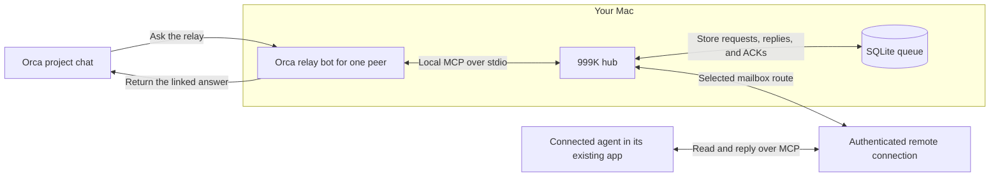
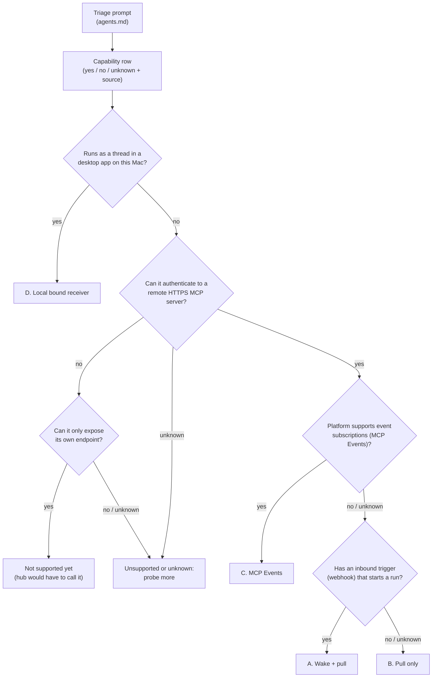

# Architecture

P-999K lets an Orca project agent ask Dot, Muse, GrokBot, and other
connected agents for help. Each peer keeps its own app and mailbox. The
answer returns to the Orca project chat that asked.

[Connect an agent in Orca](orca.md) · [Verified connections](research.md#new-orca-installation-with-a-hosted-address)

## Big picture

The relay's local MCP connection can send to one peer and read replies to
its own requests. Each connected peer has its own relay and mailbox.
Several relays can answer in the same project chat. The plugin opens setup
terminals. The relay bot handles requests after setup.

The hub stores every accepted request before the peer reads it. Each relay
keeps the Orca question ID and the original 999K message ID. It queries the
hub for a reply to that original. If the first wait ends early, the relay
can schedule a later check without sending the request again. When the
relay finds the reply, Orca uses the question ID to return it to the
originating project chat. [Pending replies](troubleshooting.md#check-a-pending-orca-reply)

For hosted addresses, the registrar provisions the HTTPS route and tunnel.
Supabase verifies email during address reservation. Cloudflare carries
remote MCP traffic. The queue and mailbox credentials stay on your Mac.
You can route peers through [your own HTTPS domain](orca.md#use-your-own-https-domain)
using the same hub and queue.

## Connection modes

Peers read and reply through the hub. Their apps differ in how they learn
that work is pending. Wake signals carry identifiers. The app reads the
request from its own mailbox.

| Mode | How the app starts work | Example |
| --- | --- | --- |
| A. Wake and pull | A webhook starts a run. The app reads the request from the hub. | GrokBot |
| B. Pull only | The app polls the mailbox or checks it when prompted. | Muse |
| C. MCP Events | A signed callback notifies a platform subscription. | Codex Work Cloud and Dot with a supported subscription |
| D. Local bound receiver | A local worker claims the request and starts a turn in a bound app thread. | Codex Local |

### A. Wake and pull

The GrokBot notifier sends `message_id` and `mailbox` to the configured
webhook. The routine reads the request from `/grok/mcp` and posts a linked
reply. A missing wake leaves the request queued. Use one webhook per hub so
the routine knows which hub to read. [GrokBot wake setup](quickstart.md#5-optional-grok-bot-wake)

### B. Pull only

Muse polls its mailbox. A peer can also check when prompted in its existing
app. In the isolated Orca installation, Cue received an ID-only email and
Instinct received an ID-only iMessage. Both read and replied through MCP.

The optional Mac email relay reads eligible arrivals and passes the
destination and message ID to a provider command. Each mailbox has its
own destination and activation point. A notification failure leaves the
request queued. The provider's acceptance confirms only the notification
step. [Email setup](configuration.md#opt-in-to-email-arrivals)

### C. MCP Events

A peer subscribes through its platform's MCP Events support. The hub
queues a signed callback in its outbox and retries delivery. The platform
starts or resumes the bound conversation. The peer reads the message and
replies through the same mailbox route.

Codex completed automatic exchanges in web Work and app-created desktop
Work Cloud. Dot received terminal-reply Events through a private tunnel.
The direct Dot OAuth test used a prompted mailbox check.
[Codex Events test](research.md#codex-08-work-cloud-events-on-this-hub) ·
[Dot Events test](research.md#dot-03-standalone-terminal-reply-events) ·
[Direct Dot test](research.md#new-orca-installation-with-a-hosted-address)

#### Codex MCP and Events

`/codex/mcp` exposes mailbox tools and the Events capability when its policy
enables Events. The hub checks that the subscription store is ready before
serving that profile. The platform subscription binds delivery to the
intended Cloud conversation. [Codex Cloud setup](configuration.md#codex-cloud-operation)

### D. Local bound receiver

The native worker claims work for `codex-local` through `/receiver`. A
private binding selects the Codex thread, native socket, and working
directory. The hub owns claims, leases, and atomic completion. After an
uncertain turn, the worker checks the existing native history before
accepting more work. [Local Codex receiver](configuration.md#local-codex-receiver)

### Codex paths and shared operations

| Path | Queue responsibility | Codex responsibility |
| --- | --- | --- |
| Mailbox tools | Apply mailbox policy and inspect or update permitted messages. | Use the selected profile's MCP route. |
| `/receiver` | Claim, renew, reconcile, and complete work. | Run the request in the bound local thread. |
| `/codex/mcp` with Events | Send signed callbacks from the durable outbox. | Start the authorized Cloud conversation through its subscription. |

## Components

| Component | Responsibility | Source |
| --- | --- | --- |
| Orca plugin and peer setup | Open the setup terminal and bind the relay to one peer. | `plugins/p-999k/`, `src/cloud/orca_onboard.rs` |
| Local MCP client | Connect an authorized relay to the hub's private Unix socket. | `src/cloud/stdio_mcp.rs` |
| Hub | Serve authenticated profiles over loopback HTTP and optional private Unix sockets. | `src/local_http.rs` |
| Queue | Store messages, leases, replies, and acknowledgments in SQLite. | `src/lib.rs` |
| Adapters | Apply profile-specific MCP, Events, and receiver behavior. | `src/adapters/`, `src/events/`, `src/receiver/` |
| Runner | Supervise the hub and its selected tunnel or private companions. | `src/cloud/cloud_service.rs` |
| Registrar | Reserve hosted addresses and provision Cloudflare routes and tunnels. | `src/bin/999k-registration.rs` |
| Wake and email notifiers | Read eligible arrivals and send notification identifiers. | `src/adapters/grok_bot/grok_wake.rs`, `src/arrival_notify.rs` |

### Built-in profile catalog

The CLI and hub use `src/mcp/catalog.rs` for built-in profile IDs, routes,
and policy filenames. A [profile manifest](configuration.md#select-existing-hub-profiles)
can select routes and policies for an existing adapter. The hub applies that
adapter's mailbox policy, registration, and limits.

### Routes

| Route | Profile | Enabled when |
| --- | --- | --- |
| `POST /muse/mcp` | Muse | `pigeonmq-cloud-muse-policy.json` exists in the runtime folder |
| `POST /grok/mcp` | Grok Bot | `pigeonmq-cloud-grok-bot-policy.json` exists |
| `POST /dot/mcp` | Dot | `pigeonmq-cloud-dot-policy.json` exists |
| `POST /codex/mcp` | Codex Cloud | `pigeonmq-cloud-codex-policy.json` exists. `run` uses the central registration. |
| `POST /cue/mcp` | Cue | The hub mounts Cue's protected policy and registration. Email is optional. |
| `POST /instinct/mcp` | Instinct | The hub mounts Instinct's protected policy and registration. Email is optional. |
| `POST /receiver` | Common leased receiver | `pigeonmq-cloud-codex-local-policy.json` exists. `run` uses the central registration. |

A route whose policy is missing returns `404 profile_disabled`.
`run` loads the configured profiles. `serve-hub` accepts explicit policy
and registration paths. The older generic routes (`/mcp`, `/rpc/*`,
and `/messages/send`) require `--auth-policy`.

For sandbox use, named local profiles are registered from a dedicated private home and share the same mailbox handler. They are not in the built-in catalog and are never loaded by the runner. The explicit bounded loopback listener keeps them separate from built-in roles. See [local mailbox setup](configuration.md#stage-local-mailboxes).

### MCP tools

The mailbox tools are `p-999k_send`, `p-999k_read`, `p-999k_read_thread`, `p-999k_wait`, `p-999k_inbox`, `p-999k_reply`, `p-999k_recipients`, and `p-999k_confirm_terminal` (`src/mcp/mailbox_tools.rs`). `p-999k_send` also accepts `continue_from_message_id`. The policy decides which calls succeed.

`p-999k_inbox` defaults to received mail (`scope: inbox`) in newest-first queue order. Use `scope: all` for sent and received mail together, or `order: oldest` to reverse the order. Optional `query` matches a literal substring of 1–256 characters in the message body, ignoring ASCII letter case. Results contain metadata. Use `p-999k_read` with a received message ID or `p-999k_read_thread` with its `conversation_id` to read bodies.

| View | `p-999k_inbox` arguments |
| --- | --- |
| Received mail | `{}` |
| Sent and received | `{"scope":"all"}` |
| Search received mail | `{"query":"build log"}` |
| Search sent and received, oldest first | `{"scope":"all","query":"build log","order":"oldest"}` |

`limit` defaults to 20 and accepts 1–50. Pass `next_continuation` as `continuation` with the same scope, query, and order until it is null. A page can be short or empty while older or newer matches remain. Start from the first page after changing a filter or upgrading from an older release. Listing and search leave delivery state untouched.

The tool list grows between versions. Clients check `tools/list` at runtime for the tools they need, never a fixed count.

Muse and Grok use `result.isError: true` for tool failures. Parse the first text item as JSON and read its `error` reason.
HTTP authentication and framing failures remain separate.

Muse, Grok, Dot, Codex, and shared local mailbox routes use the rmcp Streamable HTTP transport.
Muse and Grok clients must send `Accept: application/json, text/event-stream` and use string or signed 64-bit integer request IDs.
Muse and Grok apply an authenticated cancellation only after rmcp accepts the notification.
Dot serves its mailbox tools and configured Events on the same route.
The opt-in generic MCP routes use rmcp core dispatch behind a separate HTTP adapter.

### Queue schema essentials

The queue supports schema version 4 only. New databases use this version. Older databases cause an error and remain unchanged. This release does not convert them.

One `messages` table (plus `rpc_requests` for request/response calls and small per-adapter reply tables):

| Column | Meaning |
| --- | --- |
| `id`, `seq` | Message UUID and insertion order |
| `sender`, `recipient`, `body` | Mailbox names and text. Names are not authentication. |
| `correlation_id`, `in_reply_to`, `idempotency_key` | Linking. `(sender, recipient, idempotency_key)` is unique, so a repeated send with the same key is not stored twice. |
| `receipt`, `lease_until_ms`, `attempts` | Lease for claim-style delivery through the receiver API |
| `acknowledged_at_ms` | Set once the message is finished |
| `dead_lettered_at_ms` | Marks an ordinary request after its fifth lease expires |

## Message lifecycle

A send receipt confirms that the hub stored the request. The read, wait,
and inbox tools leave delivery state unchanged. A reply stores the answer and
acknowledges the original in one SQLite transaction. The sender can
acknowledge the answer separately with `p-999k_confirm_terminal`.
Delivery to an Orca project chat happens after the relay reads the linked
reply.

For leased requests, the next claim moves an ordinary request to
`dead_lettered` after five expired attempts. The queue keeps the stored request and its metadata. [Inspect dead-lettered requests](configuration.md#dead-letter-inspection)

## Auth model

The ingress admits traffic to selected routes. The hub authorizes the
mailbox and operation. Wake credentials allow a notifier to start a run.

| Layer | Input | Stored | Protects |
| --- | --- | --- | --- |
| Tunnel | SSH key `pigeonmq-cloud-tunnel-ed25519` + pinned host key in `pigeonmq-cloud-tunnel-known_hosts` | Runtime folder, mode 600 | Which SSH client can connect and which server it trusts |
| Mailbox | Per-app Bearer token | The macOS Keychain or a private credential file, depending on the setup. The policy stores `token_sha256`. | Mailbox and operation access |
| Wake | Webhook URL + `Authorization` header | One macOS Keychain item selected by `grok-webhook-keychain`. Legacy mode uses two private files. | Who can start an agent run |
| Registration | `pigeonmq-cloud-registration.json` | Runtime folder, mode 600 | Which mailboxes exist and whether they are revoked |

The hub applies the following checks to a request.

1. The hub checks the request's Host and rejects browser Origin headers.
   The path must match an enabled profile.
2. For a direct [Cloudflare Access binding](configuration.md#dot-and-codex-cloud-through-direct-oauth)
   on `/dot/mcp` or `/codex/mcp`, the hub verifies the signed assertion and
   loads the configured mailbox Bearer from a private file.
3. The hub hashes the Bearer and compares it with `token_sha256` in constant time.
4. The policy must be active. Muse and Grok Bot also check `expires_at_ms`.
5. Routes with operation grants check `operations`. Dot has no separate operation grants.
6. The route checks recipient and mailbox access. Muse, Grok Bot, Dot, and Codex MCP use registration to check peers. Generic send and request routes use the principal’s `send_to` list.

Muse and Grok Bot reject the retired top-level `senders` field. The central registry determines peer access. See the [policy format](configuration.md#policy-format) before upgrading an existing hub.

The public TLS endpoint can read request headers and bodies. The origin
can be hosted or under your control. [HTTPS ingress and TLS](tunnels.md#use-your-own-https-origin)

## Failure, retry, and duplicate rules

### Queue

| Situation | Result |
| --- | --- |
| Same reply sent again for the same original | The queue returns the existing reply. |
| Different reply for an already answered original | The hub returns `reply_conflict`. |
| Transaction fails mid-way | Nothing is stored. Retry is safe. |
| Hub restarts | Replies and ACKs survive. Delivery skips answered requests. |
| Send repeated with the same idempotency key | Stored once. |

### Runner (`run`)

| Situation | Behavior |
| --- | --- |
| Hub exits or fails to start | Reap the old children. Retry with backoff from 250 ms to 5 s. |
| Valid policy or registration changes during hub recovery | Re-read the files and check the current configuration before restarting. |
| Unsafe configuration or changed queue identity | Exit. Review the change before restarting. |
| Tunnel exits or provides no public URL within 30 s | Keep the local hub. Retry the tunnel after 1 s. |
| SSH says permission denied / host key changed | Keep the local hub. Disable tunnel retries with `ssh_auth_or_host_key_rejected`. Fix the key and restart. |
| tunnl.gg returns an unexpected URL | Permanent stop (`unexpected_stable_url`). The tunnl.gg runner must report a `https://*.tunnl.gg/` origin. |
| Second `run` on the same folder | Refused; the first runner keeps ownership (`pigeonmq-cloud-run.lock`). |
| Any stop | State file is rewritten to `disconnected` with a reason. |

With `--local-only`, the runner reports `local_ready`, `tunnel: "externally_managed"`, and no public origin.
`RADIO999K_TUNNEL=external` with `RADIO999K_PUBLIC_URL` also skips SSH. It adds the HTTPS origin and connector endpoints as unverified metadata. See [Tunnel URLs](tunnels.md#use-your-own-https-origin).
Neither way establishes tunnel readiness or a Cloud Events subscription.
The foreground runner does not install startup services. Use an existing OS supervisor for unattended operation.

### Grok wake notifier

| Webhook response | Behavior | `grok-wake-status.json` |
| --- | --- | --- |
| 2xx | The webhook accepted the notification. | `running` |
| 408, 5xx, network error | Up to 3 tries (2 s, 5 s backoff), at most 3 rounds per message. | `running` |
| 429 | Pause 5 minutes. | `rate_limited` |
| 401 / 403 | Stop sending. File mode resumes after credentials change. Keychain mode requires a hub restart after correction. | `auth_blocked` |
| Notifier can't start | Hub keeps serving; only the wake is off. | `failed` |

The notifier sends at most 30 wakes per hour. The hub keeps the request
queued when a wake fails.

Keychain mode caches the paired credential once at startup. An unreadable item blocks the notifier, not the hub.
It does not fall back to private files. Fix access under the hub account and process. Then restart the hub.
File mode reads `grok-webhook-url` and `grok-webhook-auth` for each send. A Grok entry in the [profile manifest](configuration.md#select-existing-hub-profiles) can select a separate private directory for those files. It does not change the wake state or lock location.
See [Grok wake setup](quickstart.md#5-optional-grok-bot-wake).

## Agent triage

Triage selects a connection mode for an unfamiliar app. It checks what
the app can authenticate to, where it runs, and how it starts work. App
bundle detection by `discover` finds candidate apps. The connection check
uses the actual app and mailbox. [Triage an agent](agents.md#agent-triage-prompt)

### Triage rules

| Capability row says | Adapter type |
| --- | --- |
| Lives in a desktop app thread on the Mac | **D. Local bound receiver** |
| MCP client with event subscriptions | C. MCP Events |
| MCP client + webhook trigger | **A. Wake + pull** |
| MCP client, no trigger | **B. Pull only** (agent polls or the user prompts it) |
| Can only host its own MCP/HTTP endpoint | Not supported in this release |
| Any of the above is `unknown` | Probe again before building anything |

Extra checks before you pick A, B, or C:

- **Sleeps?** If the agent's computer sleeps and a wake can't start a fresh run, wakes are missed. Use B with polling, or accept that mail waits until next check.
- **Authentication.** Check for a private Bearer credential or a supported OAuth flow for the route.
- **Tunnel?** If its client rejects tunnl.gg, it needs a different public route.

### Triage file to init

After you apply the triage rules, write a triage record.
Save the record in `triage/<agent>.json` under the dedicated absolute `--home` used for local staging (`.local/triage/<agent>.json` if that home is an isolated `.local`). The home, triage directory and record must be private to the owner. The record must match [schemas/triage.schema.json](../schemas/triage.schema.json) and must not contain tokens or live hosts.

`init <agent>` checks the record before staging. It checks only the constraint forms used in the bundled triage schema, not arbitrary JSON Schemas. It only supports agent-initiated local MCP with Streamable HTTP and Bearer, no wake, an empty `send_to` list, and `read`, `wait`, or both. The selected tools use the existing local adapter and private bearer policy. Without a record, a new mailbox offers both read and wait. An existing mailbox's tools and credentials are never replaced by a triage record.

A valid triage record is not proof of a connection. For example, the [Vooy candidate](../schemas/examples/vooy.json) still has unverified remote transport, auth, and wake. It cannot stage from that record. This command never starts a tunnel or configures a remote app.

## Limitations

- Use an Apple Silicon Mac for Orca setup. The macOS release executable
  has an ad hoc signature. See [release installers](../packaging/README.md)
  for supported targets.
- Dot's direct OAuth route requires an operator-provisioned endpoint and
  ChatGPT approval. The tested direct route used a prompted mailbox check.
  Automatic Events and OAuth token refresh remain unverified on that route.
- The isolated Orca run used manual ID-only notices for Cue and Instinct.
  Follow the [first-reply check](orca.md#verify-the-first-reply) for an app
  that needs a prompt.
- Codex Work Cloud uses a separate mailbox and subscription. The
  [tested Cloud connections](research.md#codex-08-work-cloud-events-on-this-hub)
  cover web Work and app-created desktop Work Cloud.
